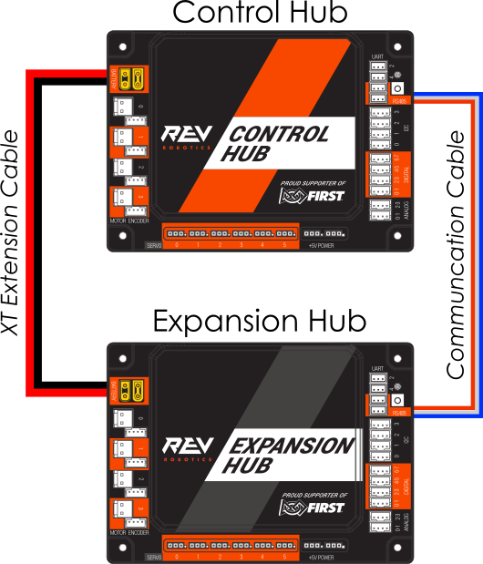
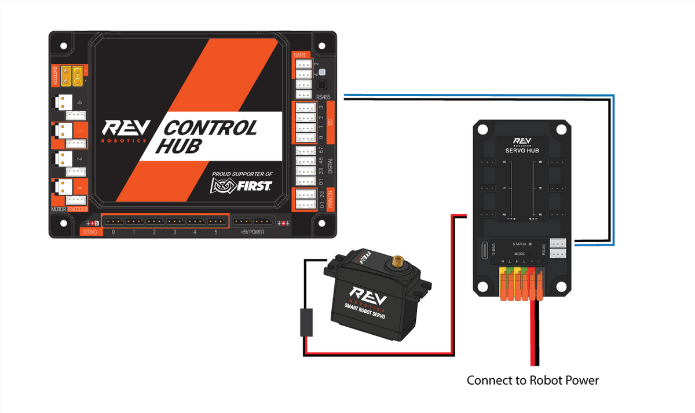
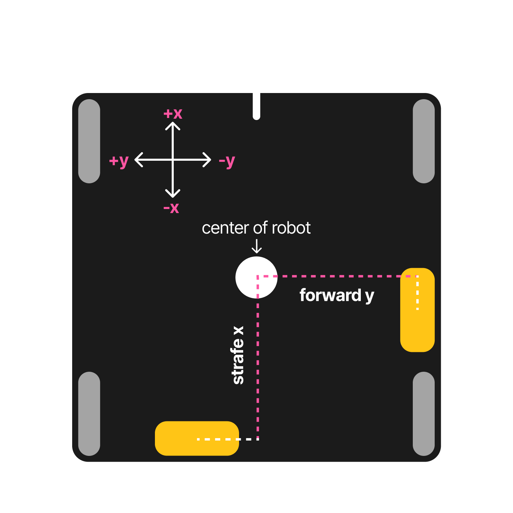

# St. Mark's FTC Biobuzz Repo For Team 23381 "The Marksmen"

## ADB connect instructions

if `adb devices` doesn't show any devices:
1. close and reopen Android Studio
2. connect to driver hub using Wi-Fi
3. run `adb kill-server && adb start-server`
4. run `adb connect 192.168.43.1`
5. now try `adb devices`

it may take a second for the control hub to show up in Android Studio

## Pedro Pathing Tuning

Using Panels interferes with Pedro Pathing's auto tuner so in order to tune Pedro Pathing you must switch to the `pedro-tuner` branch

## Panels Presets

Input our Panels presets by going to [panels-configs.md](doc/panels-configs.md)

# hardware map

driver station config name: `v0`

## control hub

### I²C ports/buses

| port/bus  | device type                  | location                    | verbatim name |
|:----------|:-----------------------------|-----------------------------|:--------------|
| `0`       | *unused*                     | *unused*                    | *unused*      |
| `1`       | Pinpoint Odo Computer        | left side under control hub | `odo`         |
| `2`       | *unused*                     | *unused*                    | *unused*      |
| `3`       | *unused*                     | *unused*                    | *unused*      |

### digital ports

| port  | device type    | location               | verbatim name           |
|:------|:---------------|------------------------|:------------------------|
| `0`   | *unused*       | *unused*               | *unused*                |
| `1`   | *unused*       | *unused*               | *unused*                |
| `2`   | *unused*       | *unused*               | *unused*                |
| `3`   | *unused*       | *unused*               | *unused*                |
| `4`   | *unused*       | *unused*               | *unused*                |
| `5`   | *unused*       | *unused*               | *unused*                |
| `6`   | *unused*       | *unused*               | *unused*                |
| `7`   | *unused*       | *unused*               | *unused*                |
| `8`   | *unused*       | *unused*               | *unused*                |

### USB ports

| port    | device       | verbatim name |
|:--------|:-------------|:--------------|
| USB 3.0 | Limelight 3A | `limelight`   |

ensure Limelight is plugged into `USB 3.0`, not `USB 2.0`

after scanning, the Limelight will show up as `Ethernet Device` under the USB devices, make sure to rename it to the verbatim name

make sure to save the config with the Limelight under a new name, as scanning may delete other devices

### DC motors

| motor port  | motor type              | verbatim name | encoder? |
|:------------|-------------------------|:--------------|:---------|
| `0`         | GoBILDA 5202/3/4 series | `frontLeft`   | ❌        |
| `1`         | GoBILDA 5202/3/4 series | `frontRight`  | ❌        |
| `2`         | GoBILDA 5202/3/4 series | `backLeft`    | ❌        |
| `3`         | GoBILDA 5202/3/4 series | `backRight`   | ❌        |

make sure to connect every motor with the correct polarity; the reversing is done in software

### servos

| servo port   | servo type       | verbatim name |
|:-------------|------------------|:--------------|
| `0`          | *unused*         | *unused*      |
| `1`          | *unused*         | *unused*      |
| `2`          | *unused*         | *unused*      |
| `3`          | *unused*         | *unused*      |
| `4`          | *unused*         | *unused*      |
| `5`          | *unused*         | *unused*      |

## expansion hub

### connection method (ports matter)

### I2C ports/buses

| port/bus | device type            | location       | verbatim name         |
|:---------|:-----------------------|----------------|:----------------------|
| 0        | *unused*               | *unused*       | *unused*              |
| 1        | *unused*               | *unused*       | *unused*              |
| 2        | *unused*               | *unused*       | *unused*              |
| 3        | *unused*               | *unused*       | *unused*              |

### DC motors

| motor port   | motor type              | verbatim name | encoder?    |
|:-------------|-------------------------|:--------------|:------------|
| `0`          | GoBILDA 5202/3/4 series | `intakeMotor` | ✅           |
| `1`          | GoBILDA 5202/3/4 series | `launchMotor` | ✅           |
| `2`          | *unused*                | *unused*      | ❌           |
| `3`          | *unused*                | *unused*      | ❌           |

## servo hub

### connection method (ports matter)

### servos

| servo port   | servo type   | verbatim name   |
|:-------------|--------------|:----------------|
| `0`          | Servo        | `transferServo` |
| `1`          | *unused*     | *unused*        |
| `2`          | *unused*     | *unused*        |
| `3`          | *unused*     | *unused*        |
| `4`          | *unused*     | *unused*        |
| `5`          | *unused*     | *unused*        |

# controller map

## sticks

### left stick

- **X**: move robot left/right
- **Y**: move robot forwards/back

the **start** button toggles between robot/field centric control

### right stick:

- **X**: rotate clockwise/counterclockwise
- **Y**: *unused*

## bumpers

- **left bumper**: auto turn (faces the goal that is up, see [localization](#localization-and-hive-detection-teleop))
- **right bumper**: shoot all balls

## triggers

- **left trigger**: slow mode (scales drive speed down to `Tunables.slowModeMin` at full pull)
- **right trigger**: *unused*

## buttons

### face buttons
- **A**: toggle intake
- **B**: toggle flywheel power
- **Y**: toggle intake reverse
- **X**: reset field centric heading
  - make sure to orient the robot towards the top of the field (in between the goals)
  - the Limelight never corrects heading, so after a TeleOp-only start (no auto run before it) press this before using auto turn

### d-pad
- **up**: increment flywheel RPM
- **down**: decrement flywheel RPM
- **left**: decrement flywheel RPM by half
- **right**: increment flywheel RPM by half

### other buttons
- **start**: toggle field/robot centric
- **back**: emergency exit from auto turn

# OpModes

## TeleOp
- `Enable/Disable Panels`: enables/disables [Panels telemetry](http://192.168.43.1:8001/)
- `BlueTeleOp`: TeleOp for blue team
- `RedTeleOp`: TeleOp for red team

## Auto

Every auto runs the same sequence: preload, drive to the shooting spot and shoot, sweep the garden and intake from the corner, drive back to the shooting spot and shoot, park at the end pose. The state machine lives in `BozoAuto`; a route is just an `AutoConfig` (poses, bezier control points, how the garden path steers).
Each blue auto owns its route as `public static` poses (exported from the Pedro visualizer) plus a `route()` method. The red autos have no poses of their own: `RedFarAuto`/`RedCloseAuto` return `BlueFarAuto.route()`/`BlueCloseAuto.route()` rotated 180 degrees about field center (`AutoConfig.rotated()`), recomputed every time the auto is initialized. So change the blue auto and the red one follows; a new field added to `AutoConfig` has to be added to `rotated()` as well.
Shooting reuses `Robot.startLaunch()` at `Tunables.autoShootRpm`.

### blue team

- `BlueFarAuto`: starts at (125.9, 8.4) by the bottom triangle, garden swept with a slight tilt
- `BlueCloseAuto`: starts at (83, 132) at the shooting spot, garden path follows its tangent

### red team

- `RedFarAuto`, `RedCloseAuto`: the blue routes above, rotated 180 degrees

## Tuner

- `FlywheelTuner`: tune flywheel PIDF
- `ServoTuner`: tune servo positions
- `VisionTuner`: tune vision

# vision

We are using a Limelight 3A

## pipelines

| filename                                  | fieldmap                                        | index  | allowed tag IDs | purpose                |
|:------------------------------------------|-------------------------------------------------|--------|:----------------|:-----------------------|
| [`Blue.vpr`](limelight/pipeline/Blue.vpr) | [`HiveBlue.fmap`](limelight/fmap/HiveBlue.fmap) | `0`    | 38-45           | blue team localization |
| [`Red.vpr`](limelight/pipeline/Red.vpr)   | [`HiveRed.fmap`](limelight/fmap/HiveRed.fmap)   | `1`    | 30-37           | red team localization  |

Many thanks to [Team 19725](https://github.com/BluePowerRobotics/Team19725_BIOBUZZ) for providing their `.fmap` files for localization!
Our localization approach is largely based off of theirs, but we use trigonometry instead of transformation matrices.

## localization and hive detection (TeleOp)

`Vision` turns each Limelight frame into a robot position and tells us which way the hive is tilted:
- the camera assumes the hive is flat, so its pose is off when the hive tilts; `Vision` uses the known pivot height and the fact that the robot sits on the floor to get the true `y` and the tilt (tilt > 0 raises the scoring side, tilt < 0 the audience side)
- the visible tag faces (audience: blue 38-41 / red 34-37, scoring: blue 42-45 / red 30-33) say which side of the hive the robot is on
- a new hive state (`AUDIENCE_UP` / `SCORING_UP`) has to be seen on `Tunables.hiveConfirmFrames` frames in a row; it stays put until the camera confirms the opposite state
- while the robot is nearly stopped and the latest fix is fresher than `Tunables.visionMaxStalenessMs`, `BozoTeleOp` pulls odometry `x`/`y` toward the Limelight position (heading always stays with odometry); turn it off with `Tunables.visionLocalization`
- **auto turn** (left bumper) aims at the goal on the side that is up; if the camera hasn't confirmed the hive yet it aims at the nearest goal; the controller buzzes once if that shot can score
  - the target is an absolute field heading, so it needs a real pose: after an auto the pose is handed over, otherwise it refuses (3 controller blips, reason in the `last auto turn` telemetry) until the heading is set with **X** and the Limelight has corrected `x`/`y` at least once

the Limelight web UI must have the camera's pose in robot space configured (position relative to the robot center and height off the floor), because `Vision` expects the botpose to be the robot's pose with `z` = 0 on the floor

# telemetry IPs and ports

- Panels: [192.168.43.1:8001](http://192.168.43.1:8001)
- robot controller: [192.168.43.1:8080](http://192.168.43.1:8080/)
- Limelight video stream: [192.168.43.1:5800](http://192.168.43.1:5801/)
- Limelight control: [192.168.43.1:5801](http://192.168.43.1:5800/)
- Pedro auto tuner (only works on `pedro-tuner` branch): [192.168.43.1:10158](http://192.168.43.1:10158/)
  - odometry tuning does not work reliably
  - find the offsets manually using the CAD and the diagram below

