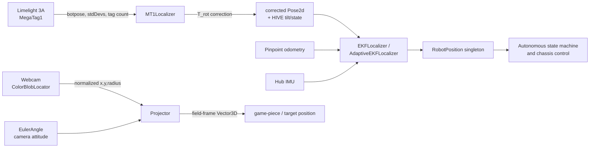

# Team 19725 BIOBUZZ — transformation-matrix vision reference

Source: <https://github.com/BluePowerRobotics/Team19725_BIOBUZZ>
Revision: `bd1028e4e76f4efb64b7fcb3362630d5e54f50f1` (master, "automatic iteration (fifth generation) 2")
Copied: 2026-11-23

This folder is a **read-only reference**, not part of Biobuzz's compiled source set.
It is placed under `TeamCode/reference/` so Gradle never sees it. Every Chinese comment
and document was translated to English; code tokens, identifiers, and package statements
are unchanged so they can be compared one-to-one with the upstream repository.

The goal is narrower than "copy their robot": it collects every place where 19725 uses
a **transformation matrix to turn camera/vision measurements into field data**, plus the
minimum surrounding code needed to understand how those numbers are consumed.

---

## 1. What is here

| Area | Files | Why it matters |
|---|---|---|
| Pinhole projection | `utility/Geometry/Projector.java`, `EulerAngle.java`, `utility/Vector2D.java`, `Vector3D.java`, `ProjectorPrompt.md` | Pixel coordinates -> camera ray -> field-frame 3D point using a full Euler rotation matrix. |
| Limelight pose correction | `Processors/VisionLocalizer/MT1Localizer.java` + its 3 design docs + `image.png` | Corrects a Limelight MegaTag1 pose that was solved against a **level** HIVE map while the real HIVE is rotated. This is a true 4x4 homogeneous-transform correction. |
| Field-map tag transforms | `fmaps/BIOBUZZ_HiveFlat_Red.fmap`, `..._Blue.fmap`, `map.md` | AprilTag poses stored as row-major 4x4 transforms; the map upload protocol. |
| Vision fusion and gating | `Processors/FusionLocalizer/*`, `Processors/RobotPosition/*`, `utility/filter/EKF/EKF.java`, `utility/filter/UKF/UKF.java`, `utility/filter/ReplayBuffer.java`, `utility/filter/Replay.md` | How the corrected pose, its covariance, and the HIVE-state observation are fused and gated; how delayed vision is rolled back instead of being applied late. |
| Live test harnesses | `OpModes/MT1Test.java`, `OpModes/FusionTestOpMode.java` | How they validate pose and tilt on the real robot, including error statistics. |
| Contracts / parameters | `RoadRunner/Localizer.java`, `Parameter/HypParams.java` | Units, validity rules, calibration constants. |

`Processors/Vision/ColorLocator.java` and `ColorLocator.md` are included because they
produce the normalized pixel coordinates that `Projector` consumes.

Not included: drivetrain, shooter, turret control, autonomous route planning. They are
translated in the full English checkout but are not part of the vision math.

---

## 2. The vision pipeline in 19725's code



Two independent paths use matrices:

1. **Limelight path** — Limelight already returns a pose; a 4x4 correction is applied
   because the loaded field map is not the physical field state.
2. **Raw-pixel path** — a blob center is converted to a camera-frame ray and rotated into
   the field frame. This is the pinhole model.

---

## 3. The math, as implemented

### 3.1 Pixel to field: `Projector` + `EulerAngle`

`Projector.project(x_p, y_p, r)` receives normalized image coordinates `x_p, y_p`
(roughly `[-1, 1]`, x right, y up) and an apparent size/scale `r`:

```java
double d = l0 / r;          // forward distance scale
double A = 1.0 / r;
Vector3D cameraCoord = new Vector3D(d, -A * x_p, A * y_p);
return pose.reform(cameraCoord);
```

So the camera ray is `(l0/r, -x_p/r, y_p/r)`. `l0` is a calibrated scale (effectively
focal length times a reference size). The signs encode the camera frame: +x forward,
+y left, +z up.

`EulerAngle.reform(v)` is the camera-to-field rotation. It applies, in this order:

```
reform = Rx(roll) * Rz(yaw) * Ry(pitch)
```

with the standard right-handed axis rotations. `transform(v)` is its exact inverse
(`Ry(-pitch) * Rz(-yaw) * Rx(-roll)`); the pair round-trips to machine precision.
Note that the composition order matters: this is an intrinsic Z-Y-X attitude description
implemented as the matrix product above, not a naive `Rz*Ry*Rx`.

The result is a 3D point in the field frame. To use it for a ground target, intersect the
ray with `z = 0` (`Vector3D.linePlaneIntersection` in the same utility package).

### 3.2 Limelight map error: `T' = T_rot(phi) * T`

19725 loads a field map that describes the HIVE in its **level** state. The physical HIVE
is rotated by `theta` about a pivot line. Limelight therefore reports a pose `T'` that is
the true pose `T` seen through an extra rigid transform:

```
T' = T_rot(phi) * T,        phi = -theta
```

For a pivot line through `p0 = (0, 0, h)` with unit direction `u = (0, 1, 0)` (their HIVE
hinge is parallel to field Y), the homogeneous correction is

```
R_y(phi) = [ cos(phi)  0  sin(phi) ]
           [ 0         1  0        ]
           [-sin(phi)  0  cos(phi) ]

T_rot(phi) = [ R_y(phi)   (I - R_y(phi)) * p0 ]
             [ 0          1                   ]
```

which expands to translation `(-h sin(phi), 0, h (1 - cos(phi)))`. In the code the pivot
axis is Y of the Limelight/FTC frame. **Biobuzz's hinge is the same physical line**: Biobuzz
converts `y_pedro = 72 - x_ll` and `x_pedro = y_ll + 72`, so a hinge at `x_ll = 0`, parallel to
`y_ll`, is Pedro's `y = visionHivePivotY = 72`, parallel to Pedro X. Only the axis names
change; the matrix is the same one.

The code recovers `phi` from the physical constraint that the robot is on the floor
(`z = 0`). Writing `A = x'`, `B = z' - h`, `C = -h`, the constraint is

```
A sin(phi) + B cos(phi) = C
phi_1 = alpha - atan2(B, A)
phi_2 = pi - alpha - atan2(B, A)
alpha = asin(C / hypot(A, B))
```

Only roots inside `±hiveCellUpAngleDeg` are accepted; if both are, the smaller `|phi|` wins.
Then the pose is corrected with `T = T_rot(-phi) * T'`:

```
x = x' cos(phi) - z' sin(phi) + h sin(phi)
y = y'
z = x' sin(phi) + z' cos(phi) + h (1 - cos(phi))
R = R_y(-phi) * R'
yaw = atan2(R10, cos(phi) * R00 - sin(phi) * R20)
```

**Degeneracy guard.** The model identically satisfies `F(0) = z'`. When the reported height
`z'` is near zero, the position equation collapses to `phi = 0` and carries no tilt
information. 19725 therefore cross-checks the position solution against the attitude
channel, which is independent:

```
pitch' ~= asin(sin(phi) * cos(yaw'))
```

If the two disagree by more than `hivePitchCheckTolDeg`, the whole frame is rejected.
This requires the robot to be level; it is invalid on a ramp.

**Validity contract.** `getPose()` returns the corrected pose only when
`isValid() && isHiveEstimated()`. Otherwise it silently falls back to the contaminated raw
pose, so every consumer must gate on both flags, as the EKF/localizer classes do.

### 3.3 Fusion matrices

`AdaptiveEKFLocalizer` builds a diagonal 3x3 measurement covariance from the MegaTag1
standard deviations and fuses `[x, y, yaw]`. It gates with the Mahalanobis distance using
the full innovation covariance rather than per-axis thresholds. `RobotPosition` then adds
hysteresis/latching for the discrete HIVE state. The UKF variant propagates sigma points
through the same measurement model; its theory document derives the weights and
covariance recovery.

### 3.4 Field-map transforms

Each `.fmap` entry is a row-major 4x4 transform mapping the tag frame into the field
frame, with translation in meters:

```json
"transform": [r00, r01, r02, tx,
              r10, r11, r12, ty,
              r20, r21, r22, tz,
              0,   0,   0,   1]
```

Tag size is 82.5 mm (`3.25 in`) and IDs are 30-45. The transforms in
`fmaps/BIOBUZZ_HiveFlat_*.fmap` describe one HIVE hinge state; `map.md` documents the
deprecated upload path.

---

## 4. What Biobuzz does today

Biobuzz already has a working vision/fusion stack. The relevant code is:

| File | Current behavior |
|---|---|
| `subsys/Vision.java` | Reads MegaTag1; converts `(x_ll, y_ll)` meters to Pedro inches with `x = y_ll + 72`, `y = 72 - x_ll`; applies a scalar z correction; applies the HIVE correction in the y-z plane and leaves x untouched ("DON'T SCREW WITH X"); classifies HIVE into `AUDIENCE_UP` / `SCORING_UP`; subtracts a heading-rotated forward/left camera error plus per-alliance biases; rejects jumps. |
| `subsys/Fusion.java` | Two independent scalar Kalman filters (x and y), process noise per inch driven, delayed-vision alignment via an odometry history, 3-sigma gate, variance inflation after repeated rejects. Heading always comes from Pinpoint. |
| `subsys/KalmanFilter.java` | Scalar predict/update, innovation variance, outlier test. |
| `Tunables.java` | Hand-fit `visionHivePivot*`, `visionZ*`, `visionCameraError*`, alliance biases, fusion noise/gate constants. |
| `tuner/VisionDataCollector.java` | Drives a serpentine grid, settles, and logs `pedroX,pedroY,pedroHeading,pedroZ,limelightX,limelightY,limelightZ,limelightHeading,tagCount` at many spots/headings. |
| `limelight/fit_hive.py` | Fits `h, pivot_y, z_offset, z_per_dist` to the scalar model from logcat lines. |

The collector is the most valuable asset: it already produces the paired data needed to
fit a full transform instead of four hand-tuned constants.

Implementation details worth noticing:

- The coordinate conversion `x = y_ll + 72`, `y = 72 - x_ll` is exactly the 2D rotation
  `R(-90 deg)` plus translation `(72, 72)`, and `heading = yaw_ll - pi/2`. It is currently
  written as four scalar expressions.
- The HIVE correction uses the same hinge as 19725 (parallel to Pedro X): it rebuilds `y`
  from the pivot geometry and leaves `x` alone. Leaving `x` alone is exactly right for an
  exact hinge, because a rotation about a line cannot change a point's coordinate along that
  line (19725 also does `correctedYIn = rawYIn`). What it does **not** do is correct yaw.
- `new VisionResult(...)` stores `new Pose(x, newY)` (raw x) even though the HIVE-corrected
  y is used. Any change to the correction must keep that contract explicit.
- `Fusion` computes `visionHeading` but never uses it; `getPose()` returns the Pinpoint
  heading. A bad initial IMU heading therefore cannot be corrected by vision.
- `VisionDataCollector` logs the raw Limelight pose and the Pedro pose, but not the
  individual tag transforms. Adding per-tag rows would enable tag-level refinement (5.3).

---

## 5. High-level plan for Biobuzz

The plan is ordered so each stage is independently testable and no stage depends on a
later one. Do not skip stage 0: it turns sign conventions into assertions.

### 5.1 The matrices for Biobuzz's current geometry

Two transforms cover almost all of Biobuzz's vision error.

**Limelight field frame to Pedro field frame.** The current scalar conversion

```java
x = botpose.y + 72;
y = 72 - botpose.x;
heading = yaw_ll - PI / 2;
```

is exactly this homogeneous transform (meters converted before this step):

```
        [ 0   1   72 ]
T_p_ll =[-1   0   72 ]
        [ 0   0    1 ]
```

The upper-left 2x2 block is `R(-pi/2)`, so the heading becomes
`yaw_ll - pi/2`; the translation is `(72, 72)`.

Keeping it as a matrix makes the red/blue mirror and any future 90-degree field
rotation a composition, not a new set of scalar signs.

**HIVE hinge correction for Biobuzz.** The current code rebuilds `y` in the
`y-z` plane and leaves `x` alone, which is the exact solution for an axis
parallel to Pedro X through `(0, pivotY, pivotHeight)`; 19725's code does the same for
its along-hinge coordinate. The two things 19725 adds are the yaw correction and the pitch
cross-check. The general transform for that axis is

```
R_x(phi) = [ 1   0        0      ]
           [ 0   cos(phi) -sin(phi) ]
           [ 0   sin(phi)  cos(phi) ]

t = (I - R_x(phi)) * (0, pivotY, pivotHeight)
  = ( 0,
      pivotY*(1 - cos(phi)) + pivotHeight*sin(phi),
      pivotHeight*(1 - cos(phi)) - pivotY*sin(phi) )

T' = T_rot(phi) * T
```

The ground constraint `(T_rot(phi) * p').z = 0` gives the same scalar equation
`A sin(phi) + B cos(phi) = C` with `A = pivotY - y'`,
`B = z' - pivotHeight`, `C = -pivotHeight`. That reduction is a useful unit
test: the matrix code must produce the same `phi` as `fit_hive.py` on the
collected data.

Once `phi` is known, rebuild `y` as today and also correct yaw from the inverse
rotation:

```
p = T_rot(-phi) * p'
R = R_x(-phi) * R'
yaw = atan2(R10, R00)
```

`x` is unchanged for an exact X-parallel hinge. The yaw correction is second order in
the tilt: zero when the robot faces along or across the hinge, and about 1 deg at 15 deg
tilt or 4 deg at 30 deg tilt when facing 45 deg (computed numerically from `R' = R_x(phi) R`).

### Stage 0 — Encode existing conversions as transforms (no behavior change)

Create one small utility, e.g. `subsys/VisionTransforms.java`, with pure functions:

```java
// Limelight field frame (meters) -> Pedro field frame (inches)
static Pose fieldFromLimelight(Pose llPose);

// Fixed residual camera mounting error, optionally heading-dependent
static Pose applyCameraExtrinsic(Pose fieldPose, double robotHeading);

// 3x3 homogeneous helpers and SE(2)/SE(3) composition
static double[] compose(double[] a, double[] b);
```

`fieldFromLimelight` is `T = translate(72, 72) * rotate(-pi/2)` applied to `[y_ll, -x_ll]`
in the current code's order. Add a unit test that feeds several `(x_ll, y_ll, yaw_ll)` and
asserts the matrix implementation equals the current scalar formulas exactly. Use this
utility from `Vision.update` and delete the duplicated scalar expressions.

**Acceptance:** identical poses to the current code on the collected CSV, test suite green.

### Stage 1 — HIVE correction including yaw and a pitch cross-check

Keep the current `y` reconstruction (it already matches 19725's position math), and:

1. Define the hinge axis unit vector `u` and a point on it `p0` in Pedro field inches.
   For Biobuzz, determine `u` from the field CAD or by fitting the collector data; the
   current model implies `u = (1, 0, 0)` and `p0 = (x_any, visionHivePivotY, visionHivePivotHeight)`.
2. Build `R = Rodrigues(u, phi)` and `t = (I - R) p0`; form the 4x4 `T_rot`.
3. Solve `phi` from the ground constraint `(R * p' + t).z = 0`. For the X-axis case this
   reduces to the same `A sin(phi) + B cos(phi) = C` equation, so the existing
   `fit_hive.py` remains valid as a cross-check.
4. Correct the full pose: `p = T_rot(-phi) * p'`, `R_robot = R(-phi) * R'`, then extract
   `yaw` from the corrected rotation matrix (`atan2(R10, R00)`), not from `yaw'`.
5. Gate with the attitude cross-check from `MT1Localizer` (`pitch' ~= asin(sin(phi)cos(yaw'))`)
   in addition to the existing distance/tag gates.

Why this is worth doing: if the hinge is exactly parallel to Pedro X, `x` is already
correct, so the real gains are (a) yaw, which the current code takes uncorrected from the
tilted attitude (up to a few degrees at large tilt), and (b) the pitch cross-check, which
rejects degenerate frames. If the fitted axis turns out not to be X-parallel, the full
transform also corrects `x`; the collector data will show it.

**Acceptance:** replay the collector CSV through old and new models; the y residual must
not regress, and the yaw residual must improve at large tilt. `x` should be unchanged
unless the fitted axis is not X-parallel. Document the fitted axis and pivot.

### Stage 2 — Replace two scalar filters with a 3-state EKF

State `[x, y, theta]` in inches/radians:

- Predict with the Pedro delta pose `[dx, dy, dtheta]` and a process covariance that grows
  with distance driven (reuse `fusionOdoVariancePerInch`).
- Measure the transformed vision pose `[x_v, y_v, theta_v]`. Build
  `R = diag(sigma_x^2, sigma_y^2, sigma_theta^2)` from `getStddevMt1()` indices 0, 1, 5,
  scaled by distance squared and tag count, then inflated by motion blur exactly as
  `Fusion.measureVisionStd` does today.
- Gate on the 3x3 innovation covariance (Mahalanobis). The current independent-axis gates
  can accept a frame whose x and y errors are individually plausible but jointly
  inconsistent, and can reject a good frame at a field corner where the errors are
  correlated through a yaw error.
- Fuse vision yaw. If Pinpoint yaw is trustworthy, give it a small measurement variance;
  if not, add a heading-bias state. Add HIVE tilt as a fourth state if you want smoothing
  instead of the current discrete classification.

**Acceptance:** on the same log, the normalized innovation squared (NEES) is consistent
with the covariance (roughly chi-square), and the fused pose does not step when the robot
turns in place.

### Stage 3 — Fit the camera/field transform from the collector

The collector already gives `(pedro pose, raw Limelight pose)` pairs over a grid and many
headings. Replace hand-fit biases with a least-squares rigid transform:

1. For each sample, form `T_pedro_ll = T_pedro_field * inverse(T_ll_field)`.
2. Estimate one `T_pedro_ll` (6-DOF) by Umeyama/SVD on all inlier samples, or fit separate
   red/blue transforms if the two pipelines have different mounting residuals.
3. Apply it as `T_field_robot = T_field_ll * T_ll_robot`. Keep the existing per-alliance
   bias only if the residual shows a real shift that is not explained by the transform.
4. Optionally refine per tag: for each visible tag, form
   `T_camera_tag = T_camera_field * T_field_tag` from the `.fmap` 4x4 and compare with the
   Limelight's measured tag transform. Minimizing these residuals attacks the actual
   error source (tag geometry and camera calibration), not just the final pose.

**Acceptance:** report translation/yaw RMS by distance and heading bin before and after;
target is sub-inch translation and sub-degree yaw at mid-field, with no bin worse than the
current model.

### Stage 4 — Pixel projection for game pieces (optional)

The 19725 `Projector`/`EulerAngle` pair is directly reusable once you have calibrated
`l0` and the camera attitude:

1. `ColorLocator` gives normalized `(cx, cy)` and radius for a blob.
2. `Projector.project(cx, cy, radius)` gives a camera-frame ray; intersect with `z = 0`
   to get a field point.
3. Because the camera is rigidly mounted, one `EulerAngle` calibration plus one `l0`
   calibration covers every frame; no per-frame solve is needed.

This is the path to use when AprilTags are occluded or when you need the position of a
game piece rather than the robot.

**Acceptance:** place a target at known field coordinates, print the projected point, and
measure the error at several distances/headings.

### Ordering and risk

| Stage | Risk | Reversible? |
|---|---|---|
| 0 | None (pure refactor) | Yes |
| 1 | Medium: wrong axis/pivot sign | Yes (feature flag / old path kept) |
| 2 | Medium: covariance tuning | Yes (Fusion is already isolated) |
| 3 | Low: offline fit, then constants | Yes (replace constants) |
| 4 | Low: separate subsystem | Yes |

Do stage 0 first and commit it alone; it gives you a matrix-based vocabulary for every
later review. Do not change the `.fmap` uploads and the pose correction in the same
commit.

---

## 6. Gotchas that cost 19725 time

1. **Limelight `snap to ground` must be `No`.** If it is `On`, the firmware forces `z' = 0`
   and the tilt information is gone; the correction will always output `theta = 0`.
2. **Use only your own HIVE's tags.** Mixing red and blue tags makes the assumed pivot
   inconsistent and corrupts the fit.
3. **The ground-cross-check assumes a level robot.** If Biobuzz later runs on a ramp,
   the `z = 0` solve and the pitch cross-check must be replaced by a full 3D state
   estimate; 19725's D3 localizer is the starting point for that case.
4. **Frames where the tilt solve fails are contaminated, not merely uncertain.**
   Gate on `isValid && isHiveEstimated` (19725) or the equivalent; never feed the raw pose
   into error statistics.
5. **Timestamp bases differ.** Limelight hardware time and `System.nanoTime()` are not the
   same clock. Convert once and keep the estimate stable for repeated reads of the same
   physical frame, or the filter will fuse the same picture twice.
6. **Units.** 19725 uses inches/radians at the FTC boundary; Limelight reports meters and
   degrees. Biobuzz is inches. Convert at the boundary only.
7. **Do not translate a 2D correction into a 3D one halfway.** The current code corrects
   `y` but takes yaw from the tilted attitude; the effect is small (a few degrees at
   large tilt) but it is the one real inconsistency.
8. **Near the hinge line the solve has two valid answers.** With `h = 43.95 in` and a 30
   deg tilt, a robot within `h * tan(30 deg) ~ 25 in` of the hinge line is reported on the
   wrong side: true `x_ll = +10` comes back as `-10` from both 19725's solver (smaller
   `|phi|` wins) and Biobuzz's (`signum(relativeY)`). Disambiguate with the previous
   accepted side or the odometry pose.

---

## 7. File map

```
TeamCode/reference/team19725-vision/
  README.md                      this document
  LICENSE                        upstream license
  fmaps/
    BIOBUZZ_HiveFlat_Red.fmap    row-major 4x4 AprilTag transforms
    BIOBUZZ_HiveFlat_Blue.fmap
  src/org/firstinspires/ftc/teamcode/
    Parameter/HypParams.java             HIVE and vision calibration constants
    Processors/Vision/ColorLocator.java  blob centers (normalized pixels)
    Processors/Vision/ColorLocator.md    SDK color-blob guide
    Processors/VisionLocalizer/
      MT1Localizer.java                  MegaTag1 read + 4x4 HIVE correction
      MT1Localizer.md                    interface and gating contract
      OneMap_MT1Localizer.md             derivation of T_rot(phi) and the root solve
      map.md                             .fmap format and upload protocol (deprecated)
      image.png                          measured HIVE angle vs tag count
    Processors/FusionLocalizer/
      EKFLocalizer.java                  baseline EKF localizer
      AdaptiveEKFLocalizer.java          vision gating, adaptive Q/R
      UKFLocalizer.java                  UKF variant
      AdaptiveUKFLocalizer.java          UKF + gating
      Theory.md                          fusion derivation
      ExperimentLog.md                   field test notes
    Processors/RobotPosition/
      RobotPosition.java                 singleton pose + HIVE state consumer
      RobotPosition.md
    OpModes/
      MT1Test.java                       standalone vision test
      FusionTestOpMode.java              four-localizer comparison and calibration
    RoadRunner/Localizer.java            localizer contract
    utility/
      Vector2D.java, Vector3D.java       2D/3D algebra used by the transforms
      Geometry/EulerAngle.java           rotation matrix, reform/transform
      Geometry/Projector.java            pinhole projection
      Geometry/ProjectorPrompt.md         intended API
      filter/EKF/EKF.java                matrix EKF core
      filter/UKF/UKF.java                matrix UKF core
      filter/ReplayBuffer.java           delayed-vision snapshot/rollback buffer
      filter/Replay.md                   replay design and timestamp contract
```

## 8. How to read this code

Read in this order:

1. `ProjectorPrompt.md` -> `EulerAngle.java` -> `Projector.java` (the smallest complete
   matrix pipeline).
2. `OneMap_MT1Localizer.md` -> `MT1Localizer.java` (the 4x4 correction and its failure
   modes).
3. `MT1Localizer.md` (contracts and gating) -> `AdaptiveEKFLocalizer.java` (consumption).
4. `Theory.md` -> `EKF.java` / `UKF.java` (fusion math).
5. `FusionTestOpMode.java` and `MT1Test.java` (how it is validated on hardware).

The Markdown files retain the original section numbers (for example "section 3.2"), so
citations between documents still line up.
